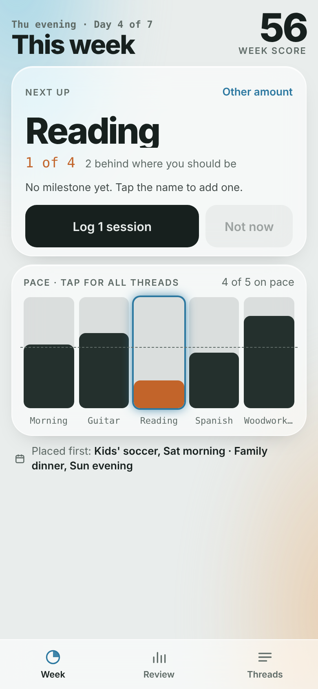
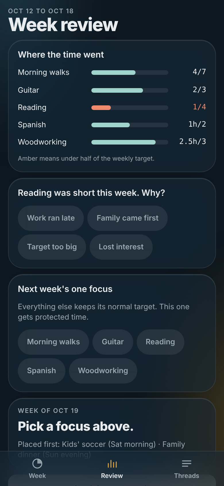
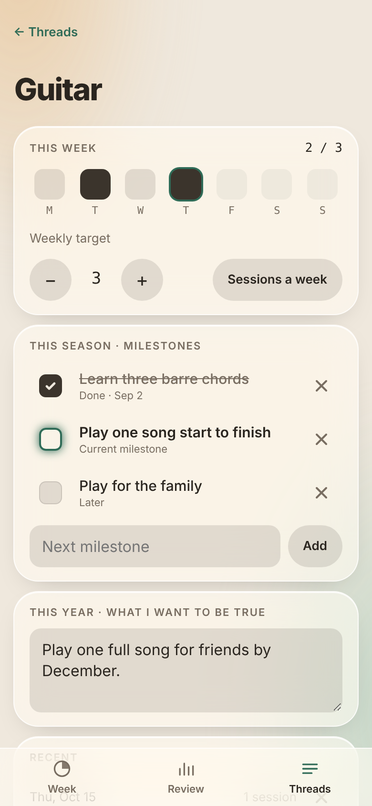

# Threads

A small phone app for seeing where free time actually goes.

<p>
  
  
  
</p>

Each thing you want your free time to go to is a thread: guitar, reading, a side project, morning walks. Each one gets a weekly target in sessions or hours. You log time with one tap or a swipe, and the app shows which thread most needs attention next. Fixed commitments are placed first, so goals fit around them instead of against them. A short Sunday review shows what got time, asks why a thread was short, and sets one focus for the next week.

## How it works

**Week.** One thread at a time in the Next up card, with a one-tap log button. Under it, a pace chart: one column per thread, filled to the share of its target reached, with a dashed line at where you should be by today. Tap the chart for the full list, where a swipe right on any row logs it.

| Move | Gesture | What happens |
| --- | --- | --- |
| Log | tap Log, or swipe a row right | Adds one session or 30 minutes for today. Undo shows for 6 seconds. |
| Other amount | tap Other amount, or + on a row | Opens a sheet with larger amounts. |
| Not now | tap Not now | Shows the next thread that is behind. |

**Pace.** A thread is on pace when what you logged is at least its target times the share of the week gone by, with half a session or half an hour of slack. The share includes the part of today already gone, so a daily thread is not marked behind first thing in the morning. Behind threads show in the warning color.

**Review.** Where the time went, a one-tap reason for each thread that came up short, and one focus for next week. The focus thread is shown first in Next up all week.

**Threads.** Each thread has a weekly target, a day-by-day view of the current week, a short ladder of milestones for the season, and a line for what you want to be true by the end of the year.

## Privacy

- Everything lives in the phone's browser storage. No account, no server, no analytics.
- CSV and JSON files are ignored by git (`.gitignore`) so a personal export never ends up in this repo.

## Install on an iPhone

1. Open `https://grahamdeno.github.io/threads/` in Safari.
2. Share > Add to Home Screen.
3. Open it from the home screen icon. It runs full screen and works offline.

## Your data

- **Back up / Restore** (Settings): one JSON file with threads, logs, reviews and settings. Keep it in iCloud Drive. Restore replaces what is in the app.
- **Export log CSV** (Settings): one row per logged entry, columns `date,thread,amount,unit`.
- **Import CSV** (Settings): same columns. Adds entries, creates any thread it does not recognize, and skips rows already in the log, so importing the same file twice changes nothing.
- The log keeps every entry. Nothing is pruned.
- Deleting the home screen icon deletes the data. Back up first.

## Themes

Six themes: Auto (follows the phone's light or dark setting), Moss, Linen, Ink, Dusk and Weave. Weave is drawn from the Threads icon. Each theme is a set of CSS custom properties, so adding one means adding one block of color values and one entry in the theme list.

## Project layout

```
index.html              the app: markup, styles, UI script
core.js                 pure logic: week dates, pace, score, version
sw.js                   service worker: offline shell, network first
manifest.webmanifest    home screen name, colors, icons
icons/                  app icon, maskable icon, favicons, source SVG
tests/                  node:test suite for core.js and release wiring
docs/                   architecture notes and screenshots
```

See [docs/ARCHITECTURE.md](docs/ARCHITECTURE.md) for how the pieces fit, how a week runs from setup to review, and the data shape.

No build step and no runtime dependencies. The only outside request is Google Fonts.

## Design decisions

- **One page, one logic file.** The UI lives in `index.html`. The date and pace math lives in `core.js`, which the page loads with a plain script tag and the tests load with `require()`. Still nothing to build or install.
- **One thing at a time.** The Week tab answers "what should I put time into next?" instead of showing every thread with equal weight.
- **Pace, not totals.** A thread with 1 of 3 sessions is fine on Monday and behind on Saturday. The chart and colors follow the day of the week.
- **Placed first.** Family and fixed commitments are listed before any goal so a short week reads as a choice, not a failure.
- **Score capped per thread.** Overdoing one thread cannot hide another that got nothing.
- **Network first service worker.** Updates show up the next time the app opens; the cache only covers being offline.

## Run it locally

```
python3 -m http.server 8000
```

Then open `http://localhost:8000`. The service worker needs `localhost` or HTTPS.

## Tests

```sh
node --test
```

Node 18 or later, no dependencies. Covers week boundaries (including daylight saving), pace, weekly totals and the score, plus the version and offline-cache wiring. GitHub Actions runs the same command on every push.

## Versioning

Releases are numbered `MAJOR.MINOR.PATCH`:

| Part | When it changes | Example |
|---|---|---|
| Major | Breaking changes, such as a stored-data change that needs migration | 1.4.0 to 2.0.0 |
| Minor | New features and enhancements. Patch resets to 0. | 1.4.0 to 1.5.0 |
| Patch | Defect fixes only | 1.4.0 to 1.4.1 |

Every release, patches included, gets a new version number. GitHub Actions adds the matching git tag (`v1.4.0`) automatically after the tests pass.

## Updating the live app

1. Set `VERSION` (and `BUILT`) in `core.js` and the matching `CACHE` name in `sw.js` (`threads-v1.4.0`). The tests fail if they differ or if the version is not three numbers.
2. Run `node --test`.
3. Push to `main`. GitHub Pages redeploys in about a minute, and once the tests pass, GitHub Actions tags the commit with the new version.
4. On the phone, close and reopen Threads, then check the version at the bottom of Settings.

## Roadmap

- iOS home screen widget showing Next up and pace
- Review reminder on the last day of the week

## License

MIT. See [LICENSE](LICENSE).
