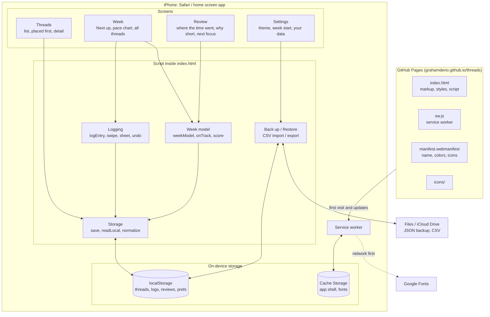
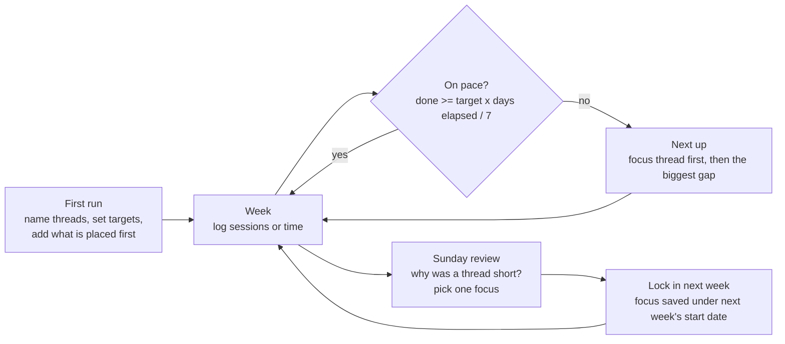

# Threads architecture

Threads is a single page app with no build step and no backend. Everything happens on the phone. The only outside services are GitHub Pages (hosting) and Google Fonts.

## Where everything sits



## A week, from setup to review



## How the Week tab decides what to show

- **Pace.** A thread is on pace when what is logged this week is at least its target times the share of the week gone by, less half a unit of slack. On Thursday of a Monday week (day 4 of 7), a 3 session target expects 1.7, so 2 sessions is on pace and 1 is behind.
- **Next up.** Threads behind pace come first, the review's focus thread ahead of the rest, then by how far behind they are relative to their target. When nothing is behind, the thread with the most left to do is shown. "Not now" steps to the next one.
- **Week score.** The average share of target reached across all threads, each capped at 100%, so one overdone thread cannot hide a starved one.

## Data shape

```json
{
  "v": 1,
  "threads": [{ "id": "…", "name": "Guitar", "target": 3, "unit": "sessions", "milestones": [{ "name": "…", "done": false }], "intent": "…" }],
  "fixed":   [{ "id": "…", "label": "Hockey", "when": "Sun evening" }],
  "logs":    [{ "id": "…", "tid": "<thread id>", "d": "2026-10-11", "amt": 1, "ts": 1791766000000 }],
  "reviews": { "2026-10-12": { "focus": "<thread id>", "reasons": { "<thread id>": "family" }, "at": 1791766000000 } },
  "setupDone": true,
  "skin": "auto",
  "weekStartsOn": 1
}
```

- Logs older than about 400 days are pruned when a new entry is logged.
- Review keys are the start date of the week they plan, so changing the week start day leaves older reviews in place under their original dates.
